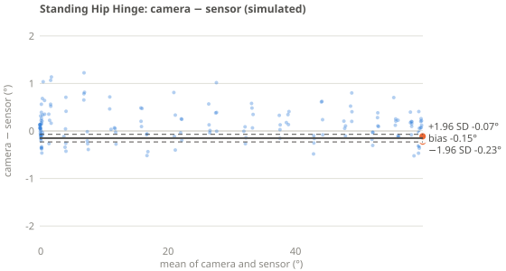
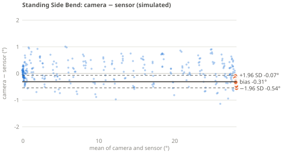
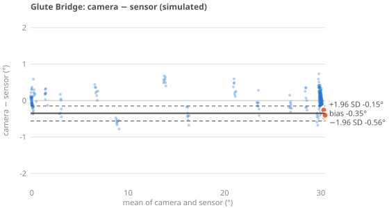

# Validation: how accurate is SpineSense?

SpineSense coaches from a single webcam. A camera can't measure the lower back well, so the question this page answers is: **how closely does the camera's trunk angle match a back-mounted motion sensor, exercise by exercise?** Two steps come before that: checking the sensor itself, and lining up the two clocks.

Everything here is reproducible. Clips are recorded in the app (Recordings page), exported as `clip.v1` JSON, and analysed by the same code that runs in the browser (`js/analysis/agreement.js`). This page's results section is generated by `tools/validate-clips.mjs`.

## 1. Validate the reference (bench test)

The sensor is the reference, so its own error must be known first.

- **Equipment:** the sensor, a flat surface, and a way to set known angles: a protractor, a phone level app, or a 3D-printed wedge (30°, 45°, 60°, 90°).
- **Procedure** (Sensors page, Bench test):
  1. Lay the sensor flat and capture 0°.
  2. Set each rig angle and capture.
  3. Each capture averages 2 s of stillness and is rejected if the sensor moved.
- **Report** the error at each angle, the largest error and the steadiness (SD).
- **Target:** within ±2° at every angle. The clinical dual-inclinometer method assumes about this level of accuracy.

## 2. Line up the clocks

Camera frames and sensor samples are stamped by different clocks, and Bluetooth delivers samples late by a variable amount. Without alignment, a 100 ms offset during a 30°/s bend becomes a 3° error in the comparison.

1. **Sensor clock to browser clock** (`js/sensors/timesync.js`): the fastest-arriving samples lie on a lower envelope that follows the true clock relationship. A straight-line fit through the per-chunk minima removes radio jitter and the sensor crystal's drift. In tests, raw arrival times were up to 140 ms off; after fitting they're within 4 ms.
2. **Camera to sensor:** cross-correlating the unfiltered camera trunk angle with the sensor angle finds the remaining constant offset: camera capture latency plus minimum radio latency. **Start each recording with a few hip hinges**, which give a strong shared signal.
3. **Smoothing delay:** the app smooths landmarks with a One-Euro filter. That adds a small delay, which is measured and reported separately.

## 3. Compare camera and sensor

- **Participants:** at least 15 people before reporting a headline number, with a mix of heights, clothing and lighting (the blueprint's minimum-data rule). Until then, report each clip separately.
- **Set-up:** the camera at hip height, 2–3 m away, as in `docs/hardware.md`. Upper sensor at T12/L1, lower sensor on the sacrum, calibrated before recording.
- **Exercises:** standing hip hinge (side-on), standing side bend (facing), glute bridge and bird dog (floor). Use the levels from each person's plan.
- **Measure:**
  - Side-on exercises: the change in camera trunk tilt from the start position vs the change in the upper sensor's inclination.
  - Facing exercises: the change in camera side lean vs the sensor's side bend.
- **Statistics** (`agreement()`):
  - **Per-rep peaks are the main comparison,** because neighbouring frames aren't independent.
  - Bias (camera − sensor) and 95% limits of agreement (Bland–Altman).
  - ICC(A,1): two-way, absolute agreement, single measures.
  - Lin's concordance (CCC), MAE and RMSE; frame-level values are secondary.

## 4. Results

<!-- results:start -->
### Simulated run (pipeline check, not real-world accuracy)

Generated 2026-10-26 by `node tools/validate-clips.mjs --simulate` from 1 clip.

> These numbers come from the simulated person and simulated sensors (with injected radio delay, clock offset and drift). They show the pipeline works end to end and recovers the timing correctly. They say nothing about real camera accuracy. Real results replace this section once clips are recorded.

**Time alignment**

| Clip | Clock offset (camera vs sensor) | Correlation | Smoothing delay |
|---|---|---|---|
| clip-mvpi7gkv-mg8x | -35 ms | 1.00 | 80 ms |

**Agreement by exercise** (rep peaks are the main result; frames are secondary because neighbouring frames are not independent)

| Exercise | Compared | Reps | Bias | 95% limits of agreement | ICC(A,1) | Frame MAE | Frame CCC |
|---|---|---|---|---|---|---|---|
| Standing Hip Hinge | trunk tilt change (°) | 8 | -0.15° | -0.23° to -0.07° | n/a (see note) | 0.28° | 1 |
| Standing Side Bend | side lean change (°) | 16 | -0.31° | -0.54° to -0.07° | n/a (see note) | 0.31° | 0.999 |
| Glute Bridge | trunk tilt change (°) | 8 | -0.35° | -0.56° to -0.15° | n/a (see note) | 0.2° | 1 |

Note: ICC not reported because the reps were all about the same depth (sensor SD under 3°), so there was too little variation for it to mean anything. Vary the depth between reps to measure it.

<!-- results:end -->

## 5. Limitations

- A simulated clip only shows the pipeline works: the simulated person is drawn from the same geometry the camera measures, so near-perfect agreement is expected.
- The sensor measures segment inclination, not spinal curvature.
- Two sensors give lumbar angle as upper minus lower, which is the dual-inclinometer method, not a direct measure of the spine.
- Frame-level statistics overstate the sample size; quote rep-level numbers.
- Camera accuracy depends on placement, clothing and lighting, so report the conditions with every result.
